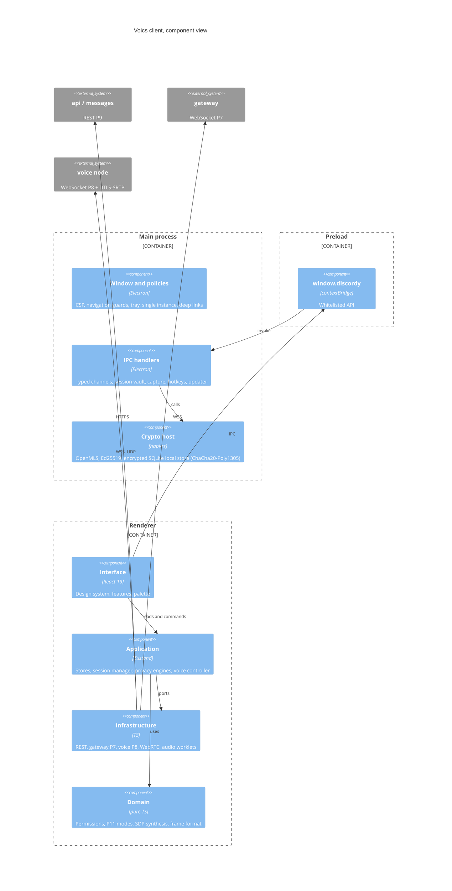

# Architecture

Clean Architecture inside the renderer: `domain` (now `packages/core/src/domain`, imported as `@discordy/core/domain/*`; REST, gateway and voice contracts are `@discordy/core/contracts`) has no framework or IO imports (enforced by eslint), `application` holds stores, use cases and ports, `infrastructure` implements ports (HTTP, gateway, WebRTC, audio), `interface` is React. `interface/app/runtime.ts` is the composition root. `domain` and `application` use no browser globals (`window`, `document`, `localStorage`; enforced by eslint) so they can move to the shared `packages/core` for the mobile app: device-local persistence goes through the `KeyValueStorage` port (`application/ports/deviceStorage.ts`), installed by `infrastructure/storage/installBrowserStorage.ts`, which the renderer entry imports first. The ports (`api`, `gateway`, `deviceStorage`) and the platform-free zustand stores live in `packages/core/src/application` (`@discordy/core/application/*`); the session, update and transfer stores and the platform-free use-case services (interactions, notification and synced-prefs sync, idle monitor, route queue, DM candidates, self presence) live there too, with their `AppInfo`, `UpdateStatus` and `AttachmentFailure` types in `@discordy/core/domain/*`; `voiceStore`, `sessionManager` (with the `StoredSession` type in `ports/sessionVault`) and `dispatchRouter` live there as well. Live media is opaque in the core (`MediaHandle`); the desktop maps it to `MediaStream` by augmenting `PlatformMedia` in `infrastructure/voice/platformMedia.d.ts`. Text-to-speech sits behind the `speech` port (`ports/speech.ts`), installed by `infrastructure/installSpeech.ts`. The REST client (`HttpClient`, `DiscordyApi`) and the gateway client live in `packages/core/src/infrastructure` (`@discordy/core/infrastructure/*`); the WebSocket is injected as a `SocketFactory` (`browserSocketFactory` in `infrastructure/net/socket.ts`) and progress uploads as a `ProgressUpload` (`infrastructure/http/browserUpload.ts`), both passed in at the composition root. The private messaging services (Ephemeral MLS groups, P2P links, attachments, the message sender) live in `packages/core/src/application/privacy` behind the `CryptoBridge` port (`application/ports/crypto.ts`) and the structural `PeerConnectionLike`; desktop supplies the napi-rs host over IPC and the browser `RTCPeerConnection`, mobile supplies an Expo module over the same Rust core and react-native-webrtc (`apps/mobile/src/privacy`). The desktop voice client keeps camera, screen share and devices on top of the shared call controller. The product identity domain rules read (name, scheme, hosts) is the `BrandConfig` in `@discordy/core/domain/brandConfig`, installed the same way by `infrastructure/brand/installBrand.ts`.

## Delivery modes

One Rust core (`native/crypto`, hexagonal: `domain`, `application`, `infrastructure`) has two thin interface layers: `interface/node.rs` (napi-rs, feature `napi`, desktop) and `interface/mobile.rs` (uniffi, feature `uniffi`, iOS). The mobile layer has the same surface as `CryptoBridge` (base64 strings, the same limits), so the Swift module `apps/mobile/modules/voics-crypto` only forwards calls; it also keeps the 256-bit store key in the iOS Keychain (`kSecAttrAccessibleAfterFirstUnlockThisDeviceOnly`) and the database in Application Support, excluded from backups. `native/crypto/ios/build-xcframework.sh` (run by the manual `crypto-ios` workflow on a macOS runner) builds the static XCFramework for `aarch64-apple-ios` and `aarch64-apple-ios-sim` and generates the Swift binding.

- **Standard**: REST send with optimistic message reconciled by nonce; a 409 `50160` triggers re-resolution and the private path.
- **Ephemeral**: one MLS group per channel (group id = channel id). Welcome and commit envelopes precede application messages over op 20. Incoming envelopes are decrypted, persisted in the encrypted local store, shown, then ACKed (op 21).
- **P2P**: WebRTC DataChannel; offer/answer/ICE relayed over op 22. Each side signs its DTLS fingerprint with its device identity key and verifies the peer's signature against the published identity key. Unverified peers are refused.

## Voice

The voice server sends a ~1 KB SESSION_DESCRIPTION, never SDP. The client creates a local offer, derives SELECT_PROTOCOL from it, and synthesizes the remote answer (`domain/sdp.ts`). Media E2EE (DAVE, protocol version 2, the only one; any other announced version is refused) uses one frame layout everywhere, the LiveKit cryptor layout in `domain/frameFormat.ts`, with 32 bytes of MLS exporter secret per sender and key index (`application/voice/epochKeyBook.ts`, `daveSession.ts`). Desktop applies it in an encoded-transform worker (`workers/frameCryptoWorker.ts`); the iPhone applies it with the native frame cryptor of `@livekit/react-native-webrtc` (`apps/mobile/src/voice/mobileFrameCryptor.ts`), which passes frames in clear until enabled, so the session (`voiceSession.ts`) attaches and enables it before any media can flow and drops frames that are not valid protected frames. H.264 is refused in E2EE calls (its clear header needs NAL parsing).

## Reporting

Reporting a message or a user is shared logic in `@discordy/core`: `domain/reportModel` holds the categories, the draft, the validation, the wording of what a report shares (`reportDisclosure`) and the request body (`buildReportBody`), and `application/reportCommands` sends it (`submitReport`, which returns an outcome instead of throwing, with `reportFailureMessage` for the rate limit and deleted targets). Both apps only render it: desktop `features/report/ReportDialog` (opened with `openDialog({ kind: 'report', target })` from the message menu, the user menu and the profile dialog) and mobile `report/ReportSheet` (from the message action sheet and the profile sheet). A Standard message is reported by ids only, because the server copies the text itself. For ephemeral and P2P chats the server holds nothing, so the report carries the author and, only when the person leaves the checkbox on, the text this device shows; the dialog says so before sending.
